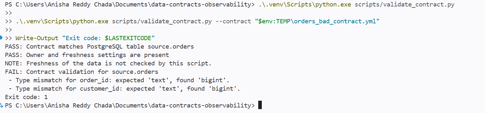

# Data Contracts and Observability Platform

A seven-day data engineering project that demonstrates how to detect
breaking data changes and monitor the quality of an orders dataset.

## Business problem

Changes to upstream data can break downstream reporting or cause
incorrect results. Delayed deliveries, unexpected volume changes, and
missing values can also affect analytics even when a pipeline succeeds.

## Project goals

- Define producer data contracts in YAML.
- Check proposed schema changes in GitHub Actions.
- Build tested dbt models in PostgreSQL.
- Validate data with Great Expectations.
- Monitor freshness, volume, and null rates.
- Capture supported lineage with OpenLineage.
- Test alerting and measure detection times using controlled scenarios.

## Planned technology

Python, PostgreSQL, Docker, dbt, Great Expectations, GitHub Actions,
OpenLineage, and Slack.

The project uses synthetic data and a local runtime simulation.

## Progress

### Day 1: PostgreSQL source

- Created a local PostgreSQL database with Docker Compose.
- Generated 1,000 synthetic orders.
- Verified that all 1,000 order IDs were unique and no customer IDs
  were missing.

### Day 2: Data contract validation

- Defined the `source.orders` data contract in YAML, including its owner,
  freshness expectation, column names, data types, and nullability.
- Built a Python validator that checks the declared columns, base data
  types, and nullability against PostgreSQL.
- Confirmed the valid contract passes.
- Tested an altered contract and confirmed the validator reports
  incompatible data types with a nonzero exit code.

The freshness setting is documented in the contract. Actual freshness
monitoring will be implemented later.

## Next step

Day 3: Add dbt models, an enforced model contract, and data tests.